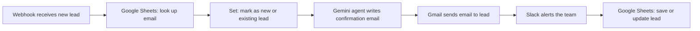

# Lead Capture and Auto-Reply

An n8n workflow that handles a new lead from the moment a form is submitted: it checks whether the person has been in touch before, sends them a personalised confirmation email, notifies the team in Slack, and saves everything to a Google Sheet.

## The problem it solves

When a lead comes in through a website form, someone has to reply, tell the team, and record the lead somewhere. Done by hand, leads get a slow reply, the team misses the alert, and repeat enquiries end up as duplicate entries. This workflow does those steps automatically.

## How it works



1. **Webhook (On New Lead):** receives the form submission as a POST request. Any form tool that can send a webhook (Tally, Typeform, a website form) can feed it.
2. **Find Existing Lead:** looks up the lead's email in the `Leads` sheet.
3. **Prepare Lead:** cleans the fields (the email is trimmed and lowercased) and sets `isNew` to true or false depending on whether the lookup found a match.
4. **Generate Lead Email:** an AI agent (Google Gemini) writes a short email. It welcomes new leads and acknowledges returning ones. A structured output parser forces the result into a `subject` and a `body`.
5. **Send Email to Lead:** sends that email through Gmail.
6. **Alert Team:** posts the lead's name, email, service and lead type to a Slack channel.
7. **Save Lead to Sheet:** adds a new row, or updates the existing row when the email already exists, so repeat enquiries do not create duplicates.

## Tools used

- n8n (workflow automation)
- Google Sheets (lead storage and duplicate check)
- Google Gemini (email generation)
- Gmail (sending)
- Slack (team alert)

## Sheet columns

The `Leads` tab needs these headers in row 1 (see `leads-sheet-template.csv`):

| Name | Email | Company | Service | Notes | Lead Type | Email Subject | Email Body | Submitted At |
|------|-------|---------|---------|-------|-----------|---------------|------------|--------------|

## Setup

1. Create a Google Sheet from `leads-sheet-template.csv`. Rename the tab to exactly `Leads`.
2. In n8n, import `workflow.json`.
3. Connect credentials for Google Sheets, Gmail, Slack and Google Gemini.
4. Replace `YOUR_GOOGLE_SHEET_ID` in both Google Sheets nodes and `YOUR_SLACK_CHANNEL_ID` in the Slack node.
5. Send a test request (n8n shows a test webhook URL when you click "Listen for test event"):

```bash
curl -X POST "<your-n8n-test-webhook-url>" \
  -H "Content-Type: application/json" \
  -d @sample-payload.json
```

`sample-payload.json` contains the fake lead used for testing. Change the email to your own address if you want to receive the confirmation email.

## Screenshots

| | |
|---|---|
| Workflow canvas after a successful run |  |
| Confirmation email received |  |
| Slack alert |  |
| Lead saved in Google Sheets |  |

## Design choices

- **Google Sheets instead of a CRM:** an earlier version used HubSpot and Airtable. A single sheet is easier to set up, easier to demo, and enough for a small lead list.
- **One save step at the end:** "append or update" matched on email replaces the separate create and update branches.
- **Structured output parser:** the email comes back as a clean subject and body instead of free text, so the next nodes can use it directly.

## Limitations

- Duplicate detection is an exact match on email address.
- The steps run in sequence. If the email or Slack step fails, the lead is not saved to the sheet. Moving the save step earlier, or adding error handling, would fix this.
- The webhook has no authentication. Add a secret header or a form-side token before using it in production.
- Google Sheets is fine for a small list but is not a real database.
- AI-written emails should be reviewed before being used with real customers.
