# AI Recruitment Screening

An n8n workflow that screens job applications automatically. It reads each applicant's resume, scores them against the requirements for the role they applied for, logs them in a Google Sheet and alerts the team. A second flow follows up when a recruiter marks a candidate as shortlisted or rejected: it drafts the email and, for shortlisted candidates, books an interview on Google Calendar.

## The problem it solves

The first part of every hiring round is repetitive: checking the form is complete, spotting people who applied twice, reading resumes, comparing them against the job, and replying to everyone. This workflow does that first pass and leaves the hiring decision to a person.

## How it works

```mermaid
flowchart TD
    subgraph A["Flow 1: New application"]
        A1["Webhook receives application"] --> A2["Clean and validate fields"]
        A2 --> A3{"All fields present?"}
        A3 -- No --> A4["Slack: incomplete application alert"]
        A3 -- Yes --> A5["Google Sheets: look up email"]
        A5 --> A6{"Already applied?"}
        A6 -- Yes --> A7["Slack: duplicate alert"]
        A6 -- No --> A8["Download resume PDF"]
        A8 --> A9["Extract resume text"]
        A9 --> A10["Gemini: parse resume"]
        A10 --> A11["Gemini: score against job requirements"]
        A11 --> A12["Google Sheets: save candidate"]
        A12 --> A13["Slack: alert team"]
        A13 --> A14["Gemini: write acknowledgement"]
        A14 --> A15["Gmail: send to candidate"]
    end
    subgraph B["Flow 2: Status change"]
        B1["Status cell updated in sheet"] --> B2{"Shortlisted or rejected?"}
        B2 -- Yes --> B3["Gemini agent writes email"]
        B3 --> B4["Gmail: create draft"]
        B3 -. shortlisted only .-> B5["Google Calendar: find slot, create interview"]
    end
```



### Flow 1: New application

1. **New Application (webhook):** receives the application as a POST request with `name`, `email`, `role` and `resume_url`. Any form tool that can send a webhook can feed it.
2. **Clean Application:** trims the fields, lowercases the email, formats the name, and works out which required fields are missing.
3. **Complete Application?:** incomplete applications go to Slack with the list of missing fields and stop there.
4. **Find Existing Candidate and Already Applied?:** looks up the email in the `Candidates` tab. A match means a duplicate, so the team is alerted in Slack and the application is not processed again.
5. **Download Resume and Extract Resume Text:** downloads the PDF from the link and pulls out the text.
6. **Resume Parsing (Gemini):** extracts skills, years of experience, education and a short profile summary as structured data.
7. **Candidate Scoring (Gemini):** scores the candidate from 1 to 10 for the role. The agent has a tool that reads the role's requirements from the `Job Requirements` tab, so the scoring rules can be changed in the sheet without touching the workflow.
8. **Prepare Candidate Row and Save Candidate to Sheet:** builds one row and appends it to `Candidates` with the status `new`.
9. **Alert Team:** posts the name, role and score to Slack.
10. **Candidate Email Generator and Send Acknowledgement:** Gemini writes a short confirmation email and Gmail sends it to the candidate.

### Flow 2: Status change

1. **Candidate Status Updated:** the Google Sheets trigger checks the `Candidates` tab every minute and fires when the `Status` cell of a row changes.
2. **Shortlisted or Rejected?:** other statuses, such as `hired`, are ignored.
3. **Status Email Agent (Gemini):** for `rejected`, it writes a respectful rejection email. For `shortlisted`, it uses two Google Calendar tools: Check Availability finds a free weekday slot between 9:00 and 17:00, and Create Event books the interview. It then writes the email confirming the time.
4. **Draft Status Email:** saves the email as a Gmail draft so a person can review it before sending.

The two flows are independent. They only share the Google Sheet.

## Tools used

- n8n (workflow automation)
- Google Sheets (candidate records, job requirements, duplicate check, status trigger)
- Google Gemini (resume parsing, scoring, email writing)
- Gmail (acknowledgement email, status email drafts)
- Slack (team alerts)
- Google Calendar (interview scheduling)

## Google Sheet structure

One spreadsheet with two tabs. `recruitment-sheet-template.xlsx` contains both.

**Candidates** (headers in row 1):

| Candidate Name | Email | Role Applied For | Resume Link | Skills | Profile Summary | AI Score | Fit Reason | Status | Submitted At |
|---|---|---|---|---|---|---|---|---|---|

`Status` accepts `new`, `shortlisted`, `rejected` or `hired`, and the template has a dropdown for it.

**Job Requirements:**

| role | required_skills | nice_to_have | min_years_experience |
|---|---|---|---|

The template includes sample requirements for six roles. Replace them with your own. The role names must match what applicants send in the `role` field.

## Setup

1. Upload `recruitment-sheet-template.xlsx` to Google Drive and open it with Google Sheets, then use File > Save as Google Sheets.
2. In n8n, import `workflow.json`.
3. Connect credentials for Google Sheets, Google Sheets Trigger, Gmail, Slack, Google Gemini and Google Calendar.
4. In the four Google Sheets nodes, pick your spreadsheet and tab from the lists: the `Candidates` tab for `Find Existing Candidate`, `Save Candidate to Sheet` and `Candidate Status Updated`, and the `Job Requirements` tab for the `Job Requirements` node.
5. Pick a Slack channel in the three Slack nodes and your calendar in the two Google Calendar nodes.
6. Test flow 1. Click "Listen for test event" on the webhook node, then send the sample payload:

```bash
curl -X POST "<your-n8n-test-webhook-url>" \
  -H "Content-Type: application/json" \
  -d @sample-payload.json
```

   `sample-payload.json` is a fake applicant. Its `resume_url` points to `sample-resume.pdf` in this folder, which is also fictional. Change the email to your own address if you want to receive the acknowledgement. If you copy this project to another repo, update `resume_url` to the raw link of your copy, or use any public PDF link.
7. Test flow 2. Change the `Status` of a candidate row to `shortlisted` or `rejected`. Within a minute the status flow runs.

## Screenshots

| | |
|---|---|
| Workflow canvas, both flows |  |
| Candidates sheet with a scored row |  |
| Slack alert for a new candidate |  |
| Acknowledgement email received |  |
| Interview created on Google Calendar |  |
| Status email draft in Gmail |  |

## Design choices

- **One Google Sheet instead of a CRM or database:** an earlier version used Airtable. A single spreadsheet with two tabs is easier to set up and easy to demo. The job requirements live in the same sheet, so the scoring rules can be edited without opening the workflow.
- **Webhook trigger:** it works with any form tool, not just one.
- **Prepare Candidate Row:** one step builds the row with the exact column names, so the save node maps columns automatically and nothing needs mapping by hand.
- **Structured output parsers:** each AI step returns defined fields (for example `score` and `fit_reason`) instead of free text, so later steps can use the values directly.
- **Drafts for status emails:** the acknowledgement is sent automatically, but shortlist and rejection emails are only drafted so a person reads them first.

## Limitations

- **AI scores are a first-pass aid, not a hiring decision.** Models can be inconsistent or biased, and a score is only as good as the requirements in the sheet. A person should review every candidate.
- **Calendar invites go out immediately.** The Create Event step adds the candidate as an attendee, so a shortlisted candidate may receive the invite before anyone has reviewed the draft email. Removing the attendee, or creating the event only after approval, would fix this.
- **Resumes must be PDF files at a direct link.** Google Drive share links open a web page rather than the file, so they do not work without a Google Drive download step.
- **Duplicate detection is an exact match on email.** The same person using two addresses is not caught.
- **The webhook has no authentication.** Add a secret header or token before using it in production.
- **The interview slot is chosen by the AI from calendar data.** Check the booked times rather than assuming they are right.
- **Google Sheets is not a real database.** The status trigger polls once a minute, and a sheet suits small hiring rounds only.
