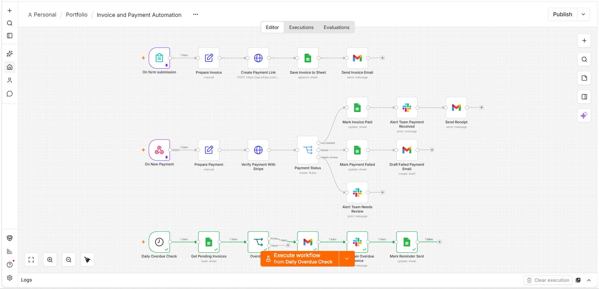
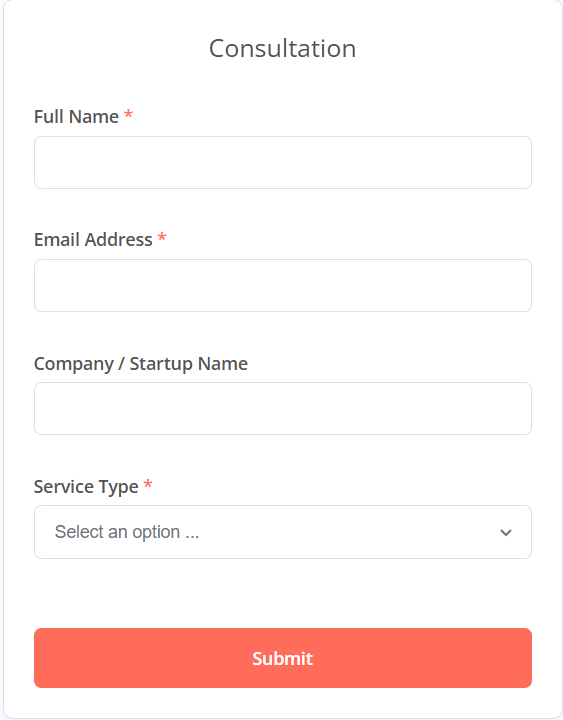
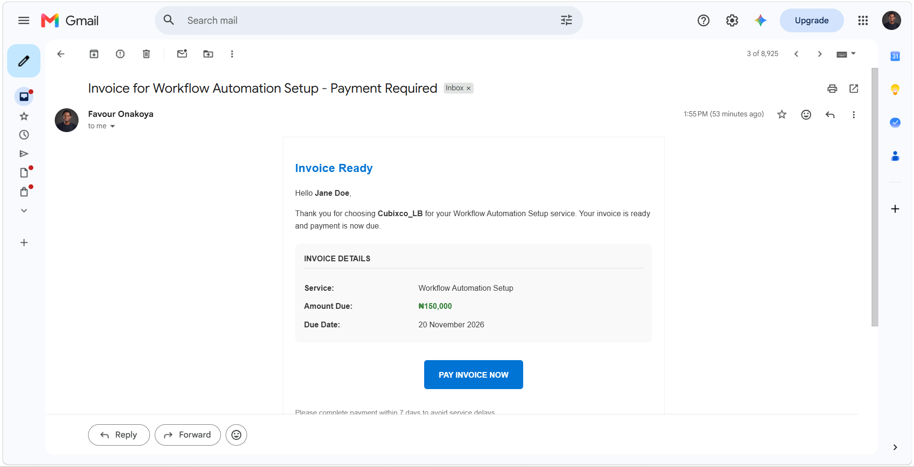
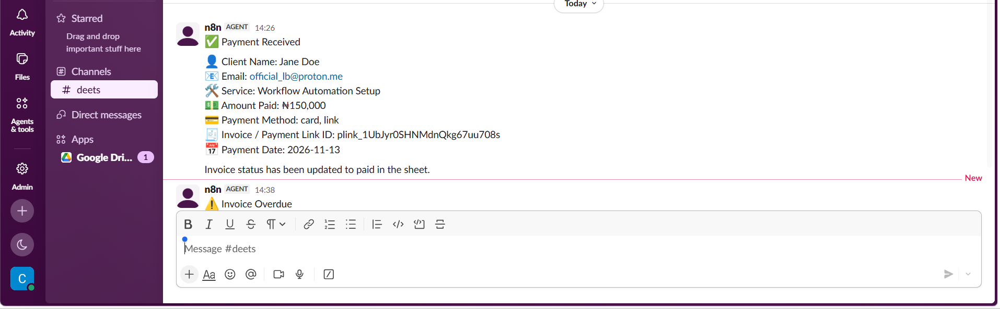
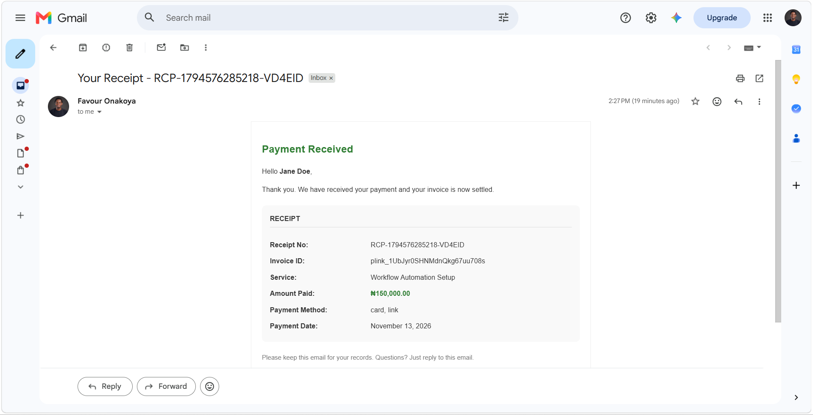
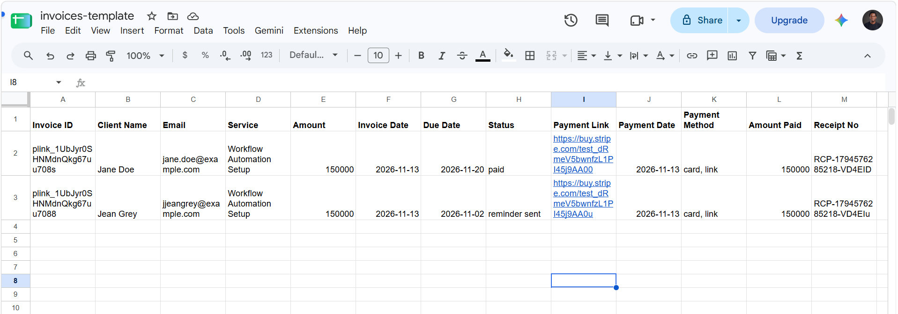
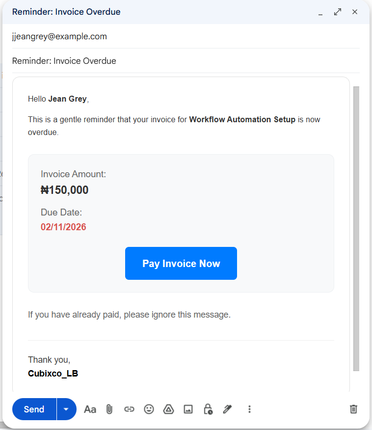
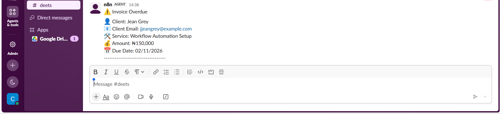

# Invoice and Payment Automation

An n8n workflow that takes a client from a service request to a paid, receipted invoice. A form creates a Stripe payment link, saves the invoice to a Google Sheet and emails it to the client. When the client pays, Stripe notifies the workflow, which confirms the payment with Stripe, marks the invoice as paid, alerts the team and emails a receipt. A daily check drafts reminders for overdue invoices.

## The problem it solves

Invoicing by hand means creating a payment link, copying it into an email, tracking who has paid, writing receipts and remembering to chase late payers. This workflow does each of those steps automatically and keeps one sheet as the record.

## How it works

```mermaid
flowchart TD
    subgraph A["Flow 1: Create and send invoice"]
        A1["Form submission"] --> A2["Prepare invoice details"]
        A2 --> A3["Stripe: create payment link"]
        A3 --> A4["Google Sheets: save invoice as pending"]
        A4 --> A5["Gmail: send invoice email"]
    end
    subgraph B["Flow 2: Payment received"]
        B1["Stripe webhook"] --> B2["Prepare payment details"]
        B2 --> B3["Stripe API: verify payment"]
        B3 --> B4{"Payment status"}
        B4 -- succeeded --> B5["Google Sheets: mark paid"]
        B5 --> B6["Slack: payment received"]
        B6 --> B7["Gmail: send receipt"]
        B4 -- failed --> B8["Google Sheets: mark failed"]
        B8 --> B9["Gmail: draft failed payment email"]
        B4 -- processing --> B10["Slack: needs manual review"]
    end
    subgraph C["Flow 3: Overdue reminders"]
        C1["Every day at 7am"] --> C2["Google Sheets: get pending invoices"]
        C2 --> C3{"Past due date?"}
        C3 -- Yes --> C4["Gmail: draft reminder"]
        C4 --> C5["Slack: overdue alert"]
        C5 --> C6["Google Sheets: mark reminder sent"]
    end
```

### Flow 1: Create and send invoice

1. **On form submission:** an n8n form collects name, email, company and a service. Each service option includes its price, for example `Workflow Automation Setup — ₦150,000`.
2. **Prepare Invoice:** cleans the name and email, splits the service from its price, converts the price to the smallest currency unit Stripe needs (×100), and sets the invoice date and a due date 7 days later.
3. **Create Payment Link:** calls the Stripe API to create a payment link for that amount. The client's name, email and service are stored on the link as metadata.
4. **Save Invoice to Sheet:** adds a row to the `Invoices` sheet with status `pending`. The Stripe payment link ID is used as the Invoice ID.
5. **Send Invoice Email:** emails the client an HTML invoice with a "Pay invoice now" button.

### Flow 2: Payment received

1. **On New Payment (webhook):** receives Stripe's `checkout.session.completed` event.
2. **Prepare Payment:** pulls out the invoice ID, amount, client details and payment date, and generates a receipt number.
3. **Verify Payment With Stripe:** asks the Stripe API for the payment's real status instead of trusting the webhook body. A fake request sent to the webhook URL cannot mark an invoice as paid.
4. **Payment Status:** routes on the status Stripe returns:
   - `succeeded`: **Mark Invoice Paid** updates the sheet row (status, payment date, method, amount paid, receipt number), **Alert Team Payment Received** posts to Slack, and **Send Receipt** emails the client an HTML receipt.
   - `canceled` or `requires_payment_method`: **Mark Payment Failed** sets the status to `failed` and **Draft Failed Payment Email** saves an email to the client as a draft.
   - `processing` or `requires_action`: **Alert Team Needs Review** posts to Slack with a link to the payment in the Stripe dashboard.

### Flow 3: Overdue reminders

1. **Daily Overdue Check:** runs every day at 7am.
2. **Get Pending Invoices:** reads only the rows whose status is `pending`.
3. **Overdue?:** keeps rows whose due date is before today.
4. **Draft Overdue Reminder:** saves a reminder with the payment link as a Gmail draft.
5. **Alert Team Overdue Invoice:** posts the client, amount and due date to Slack.
6. **Mark Reminder Sent:** sets the row's status to `reminder sent`, so the client is not reminded again the next day.

The three flows are independent. They share the Google Sheet and the Stripe account.

## Tools used

- n8n (workflow automation, form trigger, webhook, schedule)
- Stripe (payment links, payment verification, webhook events)
- Google Sheets (invoice records)
- Gmail (invoice and receipt emails, reminder and failed payment drafts)
- Slack (team alerts)

## Google Sheet structure

One tab named `Invoices`. Headers in row 1 (see `invoices-template.csv`):

| Invoice ID | Client Name | Email | Service | Amount | Invoice Date | Due Date | Status | Payment Link | Payment Date | Payment Method | Amount Paid | Receipt No |
|---|---|---|---|---|---|---|---|---|---|---|---|---|

`Status` moves through `pending`, then `paid`, `failed` or `reminder sent`.

Set the **Invoice Date**, **Due Date** and **Payment Date** columns to Format > Number > Plain text. The overdue check compares dates as text (`2026-11-13`), and Google Sheets will otherwise convert them to real dates and break the comparison.

## Setup

1. Create a Google Sheet from `invoices-template.csv`. Name the tab `Invoices` and set the three date columns to Plain text.
2. In n8n, import `workflow.json`.
3. Create a Stripe credential in n8n. Choose Header Auth, set Name to `Authorization` and Value to `Bearer ` followed by your Stripe **test** secret key (it starts `sk_test_`). Use it in both Stripe HTTP nodes: `Create Payment Link`, `Verify Payment With Stripe`. Never put the key in the workflow itself or commit it to a repo.
4. Connect credentials for Google Sheets, Gmail and Slack.
5. In the five Google Sheets nodes, pick your spreadsheet and the `Invoices` tab from the lists. Pick a Slack channel in the three Slack nodes.
6. In Stripe, add a webhook endpoint that points to your n8n webhook URL (`.../webhook/stripe-payment` when the workflow is active, `.../webhook-test/stripe-payment` while testing) and send only the `checkout.session.completed` event. The URL must be reachable from the internet, so a local n8n needs a tunnel such as ngrok.

## Testing

1. **Flow 1:** open the form, or run the node with its pinned test entry. Change the pinned email to your own address, because `example.com` will bounce. Check that the row appears in the sheet and the invoice email arrives.
2. **Flow 2:** open the payment link from the email and pay with Stripe's test card `4242 4242 4242 4242`, any future expiry and any CVC. With the webhook set up and the test event listening, Stripe sends the event and the sheet row changes to `paid`.
   - `sample-stripe-event.json` shows the shape of the event. It uses made-up IDs, so if you send it to the webhook, `Verify Payment With Stripe` will return an error. That is the verification step doing its job. A real test payment is needed to see the full path.
3. **Flow 3:** add a row with status `pending` and a past due date, then run `Daily Overdue Check` manually.

## Screenshots

| Shows | Screenshot |
|---|---|
| Workflow canvas, all three flows |  |
| The invoice request form |  |
| Invoice email received |  |
| Slack alert for a payment received |  |
| Receipt email received |  |
| Invoices sheet with the row marked paid |  |
| Overdue reminder draft in Gmail |  |
| Slack alert for an overdue invoice |  |

## Design choices

- **One Google Sheet instead of a database:** the earlier version used Airtable. One tab is enough to track invoices and is easy to set up and demo.
- **Payment verification:** the webhook only supplies the payment ID. The workflow asks Stripe for the payment's status before changing anything, so a forged webhook call cannot mark an invoice as paid.
- **HTML receipt email instead of a PDF:** the earlier version generated a PDF with PDFMonkey and stored it in Drive. An HTML email with a receipt number removes two extra services. Adding a PDF step back is possible.
- **Payment link ID as the Invoice ID:** Stripe returns this same ID in the payment event, so the paid-event can find the right sheet row without a lookup.
- **Emails that send and emails that wait:** invoices and receipts send automatically. Overdue reminders and failed payment emails are saved as drafts so a person reads them first.
- **Manual review instead of a retry loop:** payments that are still processing go to Slack with a Stripe link, rather than a wait-and-retry loop that is hard to follow.

## Limitations

- **The webhook has no signature check.** The Stripe API verification step covers the main risk, but a production setup should also verify Stripe's signature header.
- **Payment links can be paid more than once.** Stripe payment links are reusable, so a second payment on the same link re-marks the same row and sends another receipt.
- **The failed and needs-review branches rarely fire.** `checkout.session.completed` is sent when checkout finishes. Failures are only seen if the status is checked after a delayed payment method. Handling failed card attempts would also need events such as `payment_intent.payment_failed`.
- **The payment method column shows the methods the checkout offered** (for example `card, link`), not the one the client used.
- **Only one reminder is sent per invoice.** After the reminder, the row's status changes and it is no longer checked.
- **The overdue check compares dates as text,** so the date columns must stay Plain text.
- **Services and prices live in the form.** Changing a price means editing the form options.
- **The workflow is set up for test mode and Nigerian naira.** Live mode needs a live key and Stripe's live webhook.
- **Google Sheets is not a real database.** It suits a small number of invoices.
