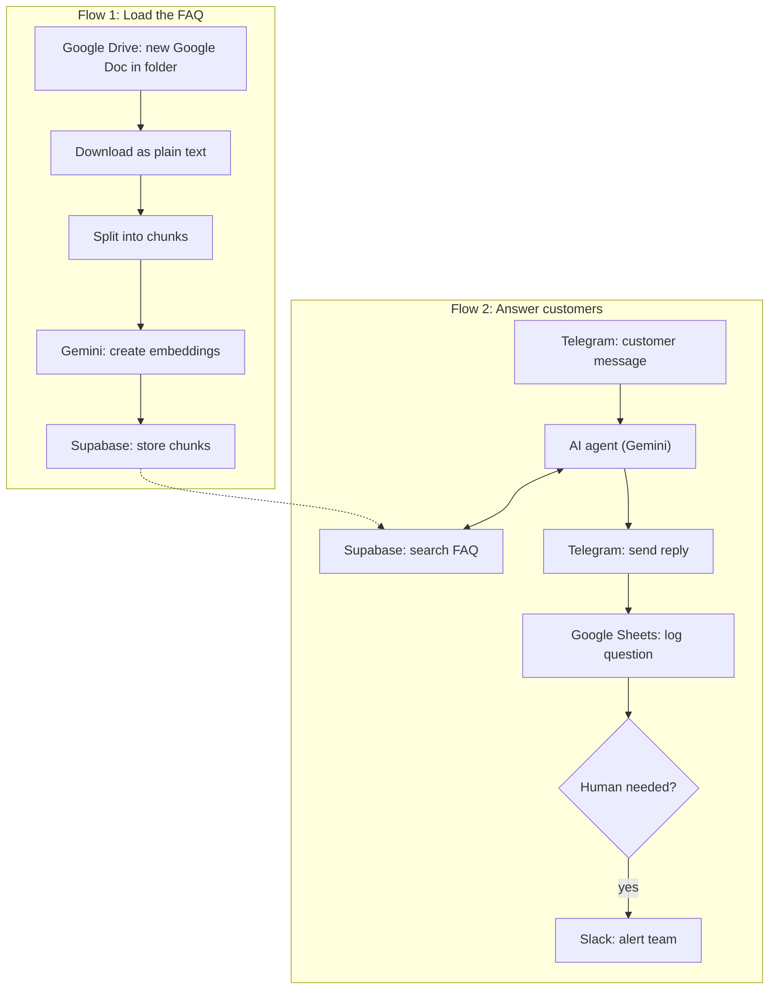
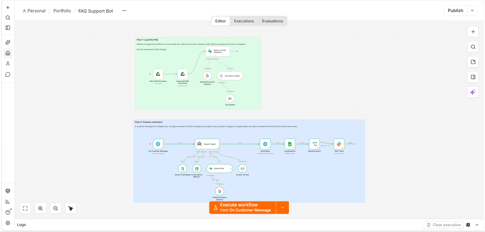
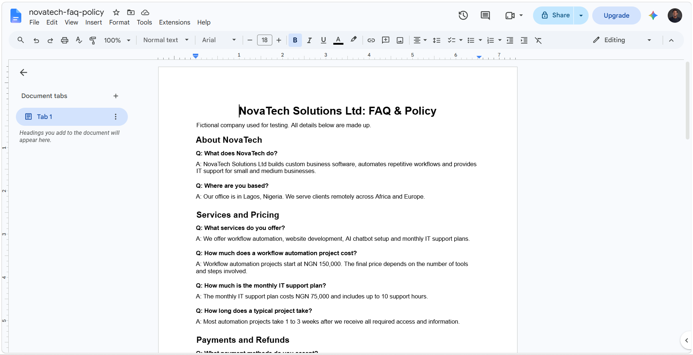
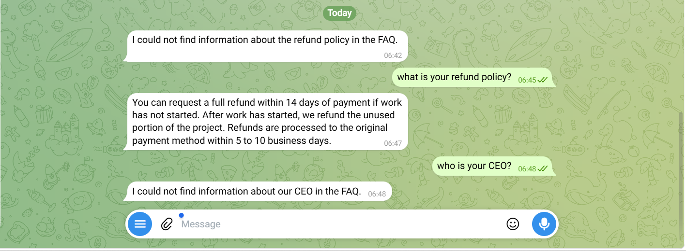
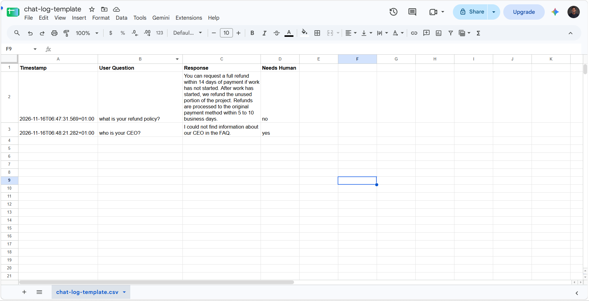
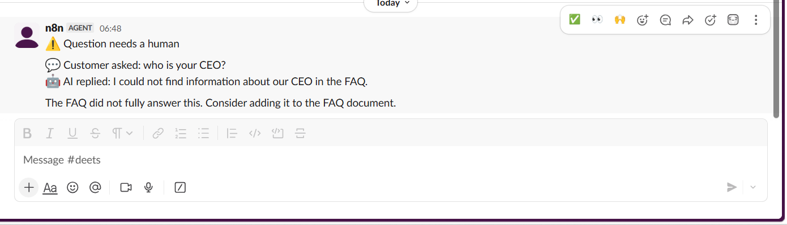

# FAQ Support Bot (RAG)

An n8n workflow that answers customer questions on Telegram using a company's own FAQ document. A new FAQ in Google Drive is split up and stored in a Supabase vector database. When a customer asks a question, an AI agent searches that database, answers only from what it finds, and logs the exchange in a Google Sheet. If the FAQ does not contain the answer, the team is alerted in Slack.

## The problem it solves

Support teams answer the same questions again and again. A bot that only answers from the company's approved FAQ takes the repetitive questions, and the Slack alert shows which questions the FAQ is missing, so the document can be improved.

## How it works



### Flow 1: Load the FAQ

1. **New FAQ Document:** checks a Google Drive folder every minute for a new Google Doc.
2. **Download FAQ Document:** exports the document as plain text.
3. **Store in Vector Database:** splits the text into chunks of 500 characters (with a 20 character overlap), turns each chunk into an embedding with Google Gemini, and saves the text and embedding as a row in the Supabase `documents` table.

### Flow 2: Answer customers

1. **On Customer Message:** a Telegram bot receives the customer's message.
2. **Support Agent:** a Gemini agent with conversation memory (keyed by the Telegram chat, so follow-up questions work). It is told to always search the FAQ first and answer only from the results.
3. **Search FAQ:** the agent's tool. It embeds the question and returns the 5 most similar chunks from Supabase.
4. **Answer Format:** a structured output parser makes the agent return `response` and `human_needed` (`yes` or `no`), so later steps can read them directly.
5. **Send Reply:** sends `response` back on Telegram.
6. **Log Question:** adds a row to the `Chat Log` sheet with the time, question, answer and `human_needed`.
7. **Needs Human?** and **Alert Team:** when `human_needed` is `yes`, a Slack message shows the question and the reply.

The two flows are independent. They share the Supabase table.

## Tools used

- n8n (workflow automation, Telegram trigger, AI agent)
- Google Gemini (chat model and embeddings)
- Supabase (vector database, using pgvector)
- Telegram (customer chat)
- Google Drive (FAQ document source)
- Google Sheets (question log)
- Slack (alerts for unanswered questions)

## Sheet structure

One tab. Headers in row 1 (see `chat-log-template.csv`):

| Timestamp | User Question | Response | Needs Human |
|---|---|---|---|

## Setup

1. **Supabase:** create a project and run this in the SQL editor. The vector size must match your embedding model. 768 is the output size of Google's `text-embedding-004`, so use your model's size if you chose another.

   ```sql
   create extension if not exists vector;

   create table documents (
     id bigserial primary key,
     content text,
     metadata jsonb,
     embedding vector(768)
   );

   create function match_documents (
     query_embedding vector(768),
     match_count int default null,
     filter jsonb default '{}'
   ) returns table (id bigint, content text, metadata jsonb, similarity float)
   language plpgsql as $$
   #variable_conflict use_column
   begin
     return query
     select id, content, metadata,
            1 - (documents.embedding <=> query_embedding) as similarity
     from documents
     where metadata @> filter
     order by documents.embedding <=> query_embedding
     limit match_count;
   end;
   $$;
   ```

2. **Credentials in n8n:** Google Drive, Google Gemini, Supabase (project URL and secret key from Project Settings, API Keys), Telegram (a bot token from BotFather), Google Sheets and Slack. Never put the Supabase secret key in the workflow file or commit it.
3. Create a Google Sheet from `chat-log-template.csv`.
4. Import `workflow.json`. Pick the Drive folder, the Supabase `documents` table (in both Supabase nodes), the Google Sheet and the Slack channel.
5. **Test document:** `novatech-faq-policy.pdf` is a fictional FAQ. Upload it to your Drive folder, right-click it and choose Open with Google Docs. The flow only watches for Google Docs, so the converted copy is the one that triggers it. Delete the original PDF afterwards.
6. Run Flow 1. The `documents` table should fill with about ten rows.
7. Message your bot on Telegram. Pin your own message on `On Customer Message` if you want to test from n8n, because the pinned chat ID in this file is fake and sending to it will fail.

## Test questions

- Answered from the FAQ: "What is your refund policy?", "What are your support hours?"
- Not in the FAQ, so Slack is alerted: "Who is your CEO?", "Do you ship hardware?"

## Screenshots

| Shows | Screenshot |
|---|---|
| Workflow canvas, both flows |  |
| The FAQ document in Google Docs |  |
| Telegram chat: one question answered from the FAQ and one the FAQ cannot answer |  |
| Chat log sheet with logged questions |  |
| Slack alert for an unanswered question |  |

## Design choices

- **Answers only from the FAQ:** the agent must search the FAQ first and is told not to invent policies or prices. An out-of-scope question is flagged instead of guessed.
- **`human_needed` flag:** a structured output parser returns it as `yes` or `no`, and the check lowercases it. An earlier version compared `"yes"` to `"Yes"` case-sensitively, so the alert never fired.
- **One vector store and one model provider:** an earlier version used Pinecone with OpenAI embeddings and a Cohere reranker next to a Supabase copy. One store with Gemini does the same job with fewer accounts.
- **Log in Google Sheets:** replaced Airtable. A sheet is enough for a log and easy to demo.
- **Sticky notes label the two flows** on the canvas.

## Limitations

- **The agent can still get it wrong.** Models sometimes answer beyond the retrieved text or mark a question as answered when it was not. A person should review the log.
- **Updating the FAQ duplicates content.** Flow 1 only runs for new documents and adds chunks. It does not remove the old version, so an edited FAQ needs the old rows deleted from the table first.
- **Only Google Docs are picked up.** PDFs must be converted to a Google Doc first.
- **Anyone can message the bot.** There is no allow list or rate limit, and every question is stored in the sheet, so a real deployment needs a privacy notice.
- **Conversation memory is kept inside n8n** and is lost if n8n restarts. A database-backed memory would keep it.
- **No reranker.** Retrieval returns the 5 closest chunks. A reranker would improve ranking on large FAQs.
- **The Supabase secret key has full database access.** Keep it only in an n8n credential.
