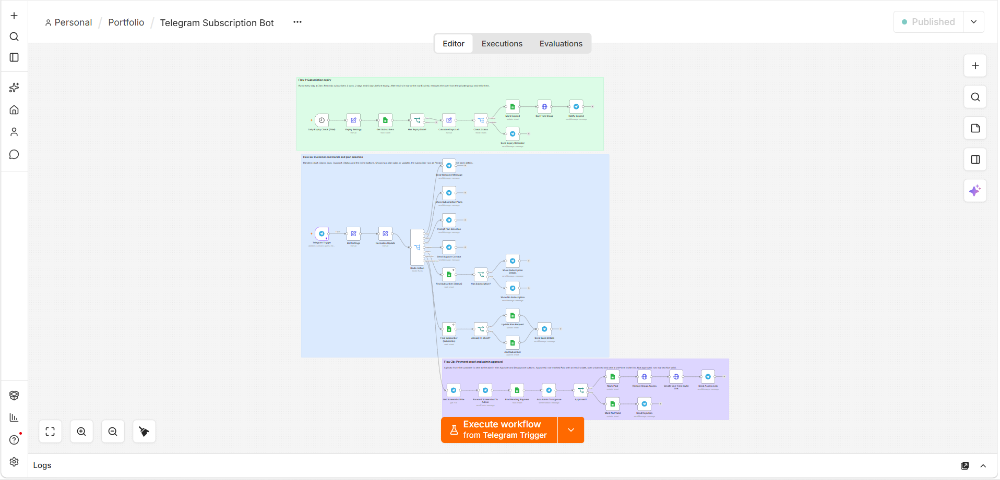
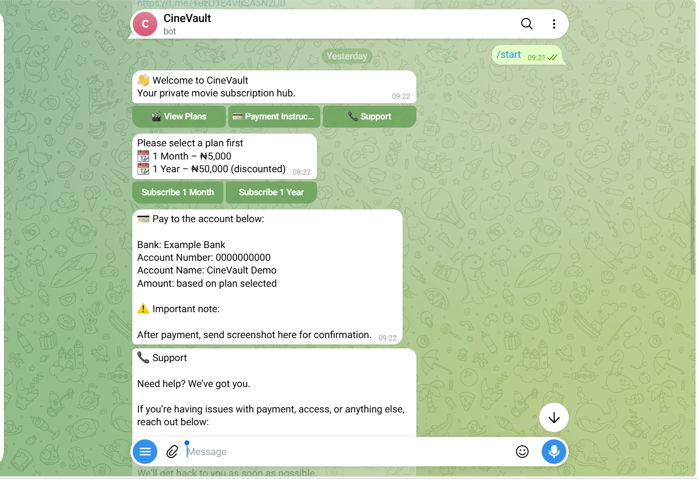
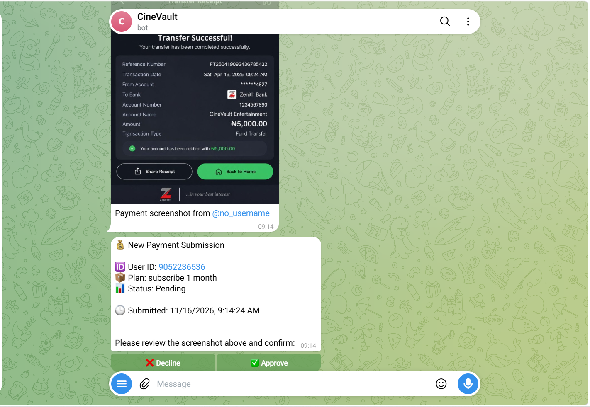
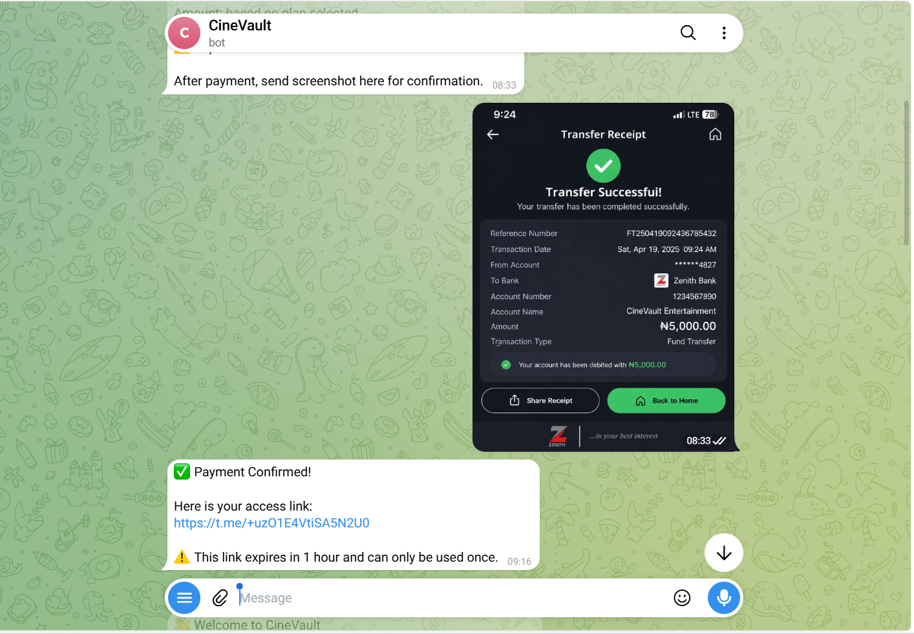
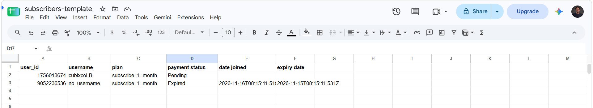
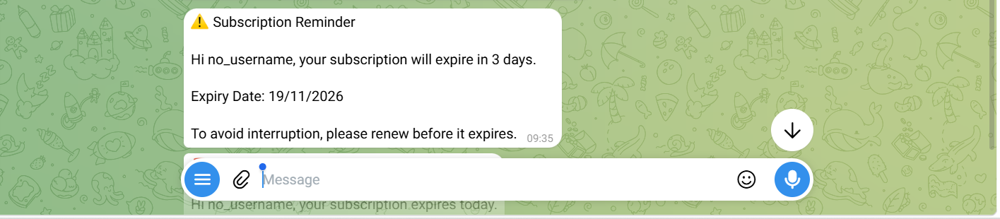

# Telegram Subscription Bot

An n8n workflow that runs a paid subscription for a private Telegram group. Customers choose a plan and pay by bank transfer, then send a screenshot of the payment to the bot. The admin approves or declines it with one tap inside Telegram. On approval, the customer gets a one-time invite link and a subscription with an expiry date. A daily check sends renewal reminders and removes people from the group when their subscription ends. Everything is recorded in one Google Sheet.

## The problem it solves

Selling access to a private group by hand means answering the same questions, tracking who paid and when each subscription ends, and remembering to remove people who stop paying. This workflow handles the customer conversation and the record keeping, and leaves the one judgement call (is this payment real?) to a person.

## How it works

```mermaid
flowchart TD
    subgraph A["Flow 1: Daily expiry check"]
        A1["Every day at 7am"] --> A2["Google Sheets: get subscribers"]
        A2 --> A3["Calculate days left"]
        A3 --> A4{"Days left"}
        A4 -- "3, 2 or 0" --> A5["Telegram: send reminder"]
        A4 -- "past expiry" --> A6["Google Sheets: mark Expired"]
        A6 --> A7["Telegram API: remove from group"]
        A7 --> A8["Telegram: tell the user"]
    end
    subgraph B["Flow 2: Customer messages"]
        B1["Telegram trigger"] --> B2["Work out chat ID and action"]
        B2 --> B3{"Which action?"}
        B3 -- "/start, /plans, /pay, /support" --> B4["Telegram: reply"]
        B3 -- "/status" --> B5["Google Sheets: find subscriber"] --> B6["Telegram: show status"]
        B3 -- "choose a plan" --> B7["Google Sheets: add or update row as Pending"] --> B8["Telegram: send bank details"]
        B3 -- "payment screenshot" --> B9["Telegram: send screenshot to admin"]
        B9 --> B10["Admin taps Approve or Decline"]
        B10 -- Approve --> B11["Mark Paid with expiry date"] --> B12["Telegram API: allow back into group"] --> B13["Telegram API: create one-time invite link"] --> B14["Telegram: send link to customer"]
        B10 -- Decline --> B15["Mark Not Valid"] --> B16["Telegram: tell the customer"]
    end
```

### Flow 1: Daily expiry check

1. **Daily Expiry Check (7AM):** runs every morning.
2. **Get Subscribers and Has Expiry Date?:** reads every row and keeps those with an expiry date that are not already `Expired`.
3. **Calculate Days Left:** works out the number of whole days until expiry.
4. **Check Status:**
   - **3, 2 or 0 days left:** **Send Expiry Reminder** messages the subscriber.
   - **Past expiry:** **Mark Expired** updates the row, **Ban From Group** removes the user from the private group through the Telegram API, and **Notify Expired** tells them how to renew.

### Flow 2: Customer messages

1. **Telegram Trigger, Bot Settings and Normalize Update:** every message or button press is turned into a chat ID, a username and an `action`.
2. **Route Action:** sends each action down its own path.
   - `/start`, `/plans`, `/pay` and `/support` get a reply, mostly with buttons.
   - `/status` looks the customer up in the sheet and shows their plan, dates and status.
   - Choosing a plan adds the customer to the sheet as `Pending`, or updates their existing row, then sends the bank details.
   - A photo is treated as a payment screenshot.
3. **Payment approval:** **Get Screenshot File** and **Forward Screenshot To Admin** send the photo to the admin. **Find Pending Payment** finds the customer's pending row and **Ask Admin To Approve** sends the admin the details with Approve and Decline buttons, and the flow waits for the tap.
4. **Approved:** **Mark Paid** sets the status, a start date and an expiry date (one month or one year ahead). **Restore Group Access** lifts any earlier ban, **Create One-Time Invite Link** makes a link that works once and expires in an hour, and **Send Access Link** sends it to the customer.
5. **Declined:** **Mark Not Valid** updates the row and **Send Rejection** tells the customer to retry or contact support.

The flows are independent. They share the Google Sheet and the Telegram bot.

## Tools used

- n8n (workflow automation, Telegram trigger, wait-for-approval)
- Telegram Bot API (customer chat, admin approval, group membership and invite links)
- Google Sheets (subscriber records)

## Google Sheet structure

One tab. Headers in row 1 (see `subscribers-template.csv`):

| user_id | username | plan | payment status | date joined | expiry date |
|---|---|---|---|---|---|

- `plan` is `subscribe_1_month` or `subscribe_1_year`.
- `payment status` is `Pending`, `Paid`, `Not Valid` or `Expired`.
- Set the **date joined** and **expiry date** columns to Format > Number > Plain text. The workflow writes dates as text, and Google Sheets will otherwise convert them.

## Setup

1. **Create the bot:** in Telegram, message @BotFather, send `/newbot` and keep the token private.
2. **Create a private group** and add your bot as an admin with permission to ban users and invite users via link.
3. **Find the IDs:** the group ID starts with `-100`. To find it, run the Telegram Trigger in test mode and post in the group, then read `message.chat.id`. The admin chat ID is your own Telegram user ID, found the same way by messaging the bot. The admin must have sent `/start` to the bot at least once, and the admin has to be a person, since a bot cannot message another bot.
4. **Create a Google Sheet** from `subscribers-template.csv` and set the two date columns to Plain text.
5. **Import `workflow.json`** into n8n and connect credentials for Telegram and Google Sheets. Use the same Telegram credential on every Telegram node.
6. **Fill in the two Settings nodes** (`Expiry Settings` and `Bot Settings`) with the bot token and the group ID, and the admin chat ID in `Bot Settings`. The Telegram API calls for banning, unbanning and invite links need the token in the request URL, which n8n credentials cannot supply, so the token lives in these nodes. Remove the values before exporting the workflow for sharing.
7. **Pick your spreadsheet and tab** in each of the nine Google Sheets nodes.
8. In `Ask Admin To Approve`, turn on **Approve Within Chat** under Advanced Interactivity so the admin can approve with buttons inside Telegram.
9. Replace the demo prices, bank details and `@your_support_username` in the message nodes.
10. n8n must be reachable from the internet, because Telegram sends messages to it. A local n8n needs a tunnel such as ngrok.

## Testing

1. Send `/start` to the bot and tap through Plans and Subscribe 1 Month. A `Pending` row should appear.
2. Send any photo as a payment screenshot. The admin account receives it with Approve and Decline buttons.
3. Tap Approve. The row becomes `Paid` with an expiry date, and the customer receives an invite link.
4. To test the daily check, edit a row's expiry date to three days from today, then run `Daily Expiry Check (7AM)` manually. To test expiry, set the date to yesterday.

The pinned test message in this file uses a fake chat ID, so replace it with your own message before running the nodes that send replies.

## Screenshots

| Shows | Screenshot |
|---|---|
| Workflow canvas, both flows |  |
| The bot's welcome message and plans |  |
| The admin receiving a screenshot with Approve and Decline buttons |  |
| The customer receiving the one-time invite link |  |
| Subscribers sheet with a Paid row |  |
| A renewal reminder from the daily check |  |

## Design choices

- **Manual approval of payments:** customers pay by bank transfer, so there is no payment API to confirm the money arrived. The admin checks the screenshot against the bank app and approves it in one tap.
- **Ban at expiry, unban on renewal:** removing someone from the group with a ban means they cannot rejoin with an old invite link. When a renewal is approved, the workflow lifts the ban and sends a fresh single-use link.
- **One step turns every update into the same fields:** the trigger receives both messages and button presses. `Normalize Update` produces one chat ID, username and action, so the router and later nodes do not need separate paths for each kind of update.
- **Settings in one place:** the bot token, group ID and admin ID are edited in the Settings nodes instead of being typed into the HTTP nodes.
- **HTML parse mode on messages:** Telegram's default Markdown mode rejects messages containing underscores, such as in usernames or invite links, so the messages are sent as HTML.
- **One sheet instead of a database:** one row per customer is enough for a small subscription group and easy to demo.

## Limitations

- **The admin must check payments by hand.** A screenshot can be faked, so the admin should confirm the money in the bank account before tapping Approve.
- **Renewal resets the status.** Choosing a plan again while subscribed changes the row to `Pending`. The reminders and the removal at expiry still follow the old expiry date until a new payment is approved.
- **One row per customer.** Renewals overwrite the plan and dates, so there is no payment history.
- **A photo without a pending plan is ignored.** The admin still receives the image, but the flow stops after the lookup finds no pending row, and the customer is not told.
- **Unrecognised messages get no reply.** Only the listed commands and buttons are handled.
- **Reminders go out at 3, 2 and 0 days.** There is no reminder at 1 day, and each is only sent if the 7am check runs that day.
- **Dates follow the n8n server's time zone.** An expiry may switch a few hours early or late for users elsewhere.
- **The bot token has to be placed in the Settings nodes.** Anyone who can open the workflow can read it, so keep real values out of exports.
- **Google Sheets is not a real database.** It suits a small group, and two simultaneous approvals could overwrite each other.
