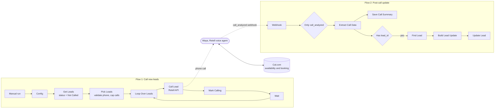
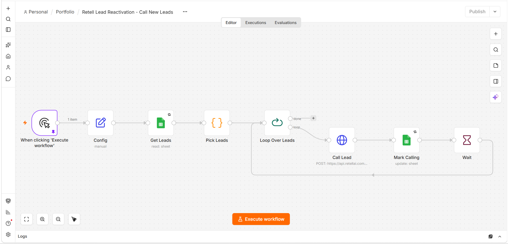
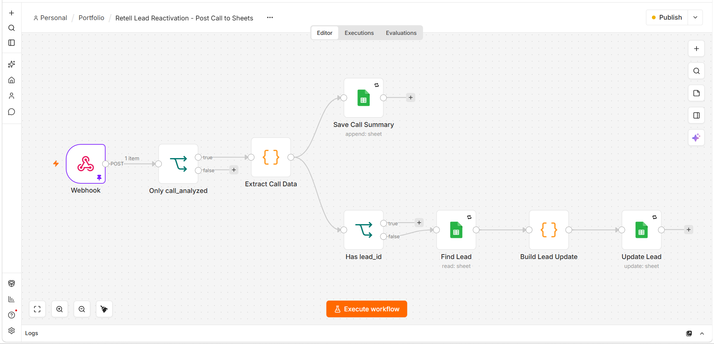
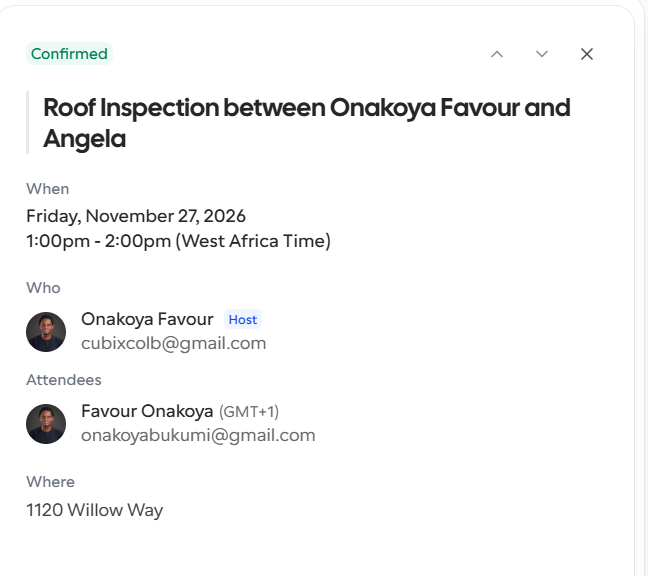
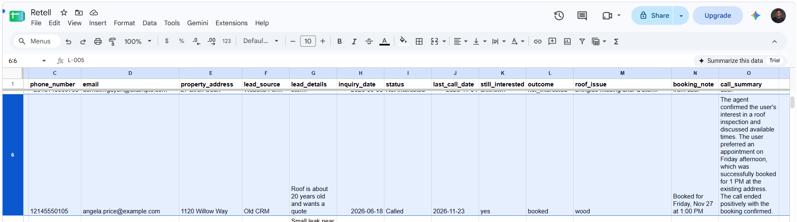
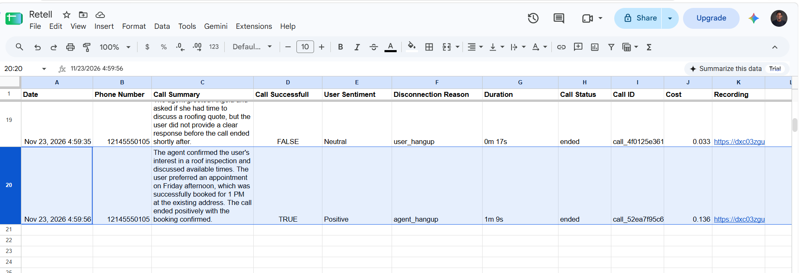

# Voice Agent: Retail Lead Reactivation

An AI voice agent that phones old roofing leads, finds out whether they still need help, and books a free roof inspection on the company calendar. n8n starts the calls and writes every result back to Google Sheets.

The example business is a fake roofing company (LB Roofing). The agent is built on [Retell](https://www.retellai.com), bookings go to Cal.com, and all leads in this repo are made up.

## Demo

[Watch the demo recording](https://clb.neetorecord.com/watch/d97079d2a9139212f724): the voice assistant follows up on an old estimate request, checks whether the lead still needs the work, answers their questions and books the inspection on the calendar.

## What it does

1. **Pick leads.** n8n reads the Leads tab and takes leads whose status is `Not Called`. It rejects rows without a valid `+` international phone number and stops at a set number of calls (`max_calls`).
2. **Call.** For each lead, n8n asks Retell to start a phone call and passes the lead's name, source, details and address to the agent. The row is marked `Calling` so it is not picked twice.
3. **Talk and book.** The agent (Maya) greets the lead, asks whether they still need help, and offers one free inspection. If they say yes, it checks live Cal.com availability, confirms the address, and books the slot.
4. **Write results back.** When the call ends, Retell sends the analysis to an n8n webhook. n8n saves a row in the Call Summary tab and updates the lead's row with the outcome, roof issue, booking note and any corrected name, phone or address.

## How it works

## The agent

- **Tone:** relaxed and low pressure. It offers the inspection once and accepts a no.
- **Guardrails:** never says a booking is made before the booking tool succeeds, never books without a fresh availability check and a clear yes, never invents prices or availability, only transfers to a person Monday to Friday 8am to 6pm, and says it is an AI if asked.
- **Edge cases handled in the prompt:** bad time, already hired someone, "how did you get my number", price questions, wrong person, do not call again, tool failure and prompt-injection attempts.
- **Post-call fields:** `still_interested`, `outcome`, `roof_issue`, `alternate_phone_number`, `updated_property_address`, `updated_customer_name`, `booking_note`.

The full prompt, tools and fields are in [`agent-prompt.md`](./agent-prompt.md). The sanitized export is [`agent-config.json`](./agent-config.json).

## Files

| File | What it is |
|------|------------|
| `workflow.json` | Both n8n flows on one canvas, labelled Flow 1 and Flow 2. Import into n8n. |
| `agent-config.json` | Retell agent export with IDs, webhook URL and email replaced by placeholders. |
| `agent-prompt.md` | The agent prompt, tools and post-call fields in readable form. |
| `lead-reactivation-sheet-template.xlsx` | Google Sheets template with two tabs: `Leads Mock` (10 fake leads) and `Call Summary - all` (headers only). |
| `sample-retell-webhook.json` | A trimmed sample of what Retell sends after a call. It is pinned on the Webhook node so Flow 2 can be tested without a real call. |
| `screenshots/` | Screenshots of the run. |

## Setup

1. **Sheet.** Import `lead-reactivation-sheet-template.xlsx` into Google Sheets. Keep both tabs and all column names exactly as they are.
2. **Retell.** Create an agent, import `agent-config.json`, and set:
   - the webhook URL to your n8n production webhook URL for Flow 2,
   - your Cal.com connection, event type ID and timezone,
   - the `office_number` variable for transfers.
3. **n8n.** Import `workflow.json`, then:
   - connect your Google Sheets account and pick the sheet and tab on each Google Sheets node (reselecting a sheet clears the column mapping, so check the mapping afterwards),
   - add a Retell API key as a Header Auth credential on `Call Lead` (header `Authorization`, value `Bearer YOUR_KEY`),
   - fill in `from_number` (your Retell number) and `agent_id` in the `Config` node.
4. **Test Flow 2.** Run it from the pinned sample. The lead `L-005` row should update and a new row should appear in Call Summary.
5. **Test Flow 1.** Leave `max_calls` at 1 and change a lead's phone to a number you control. Run it manually.

## Example call

A test call to the fake lead Angela Price. The agent booked the inspection for Friday, November 27 at 1 PM.

> **Agent:** Hi Angela, I'm Maya from LB Roofing. You reached out a while back about a quote for your roof since it's around twenty years old. Do you have a minute?
> **Lead:** Yeah, sure.
> **Agent:** Do you still need help with your roof?
> **Lead:** Yeah, I don't mind someone coming down.
> **Agent:** What's going on with the roof?
> **Lead:** Yeah, it's just wood, that's all.
> **Agent:** How soon do you want someone to take a look?
> **Lead:** Today's Monday, right? Maybe by Friday.
> **Agent:** Let me check the calendar for before Friday. We've got plenty of options. Would Tuesday at 8 or 9 in the morning work?
> **Lead:** Friday, Friday.
> **Agent:** Friday's wide open. Would 8 or 9 in the morning work?
> **Lead:** Maybe some time in the afternoon, maybe by 1 PM.
> **Agent:** 1 PM works. Is the inspection still at 11:20 on Willow Way?
> **Lead:** Yeah, sure.
> **Agent:** Alright, let me get that booked for you. You're all set for Friday, November 27th at 1 PM. Talk to you then!

Retell's summary of the call: *The agent confirmed the user's interest in a roof inspection and discussed available times. The user preferred an appointment on Friday afternoon, which was successfully booked for 1 PM at the existing address. The call ended positively with the booking confirmed.*

## Screenshots

| # | Screenshot | Shows |
|---|------------|-------|
| 1 |  | Flow 1 on the n8n canvas |
| 2 |  | Flow 2 on the n8n canvas |
| 3 |  | The inspection booked in Cal.com, with day, time and address |
| 4 |  | The lead's row updated with outcome and booking note |
| 5 |  | The new row in Call Summary |

## Known limitations

- **Attendee email is fixed.** The Cal.com booking tool uses one placeholder email, so confirmations do not reach the lead. The Leads tab already has an `email` column. Passing it to the agent as a variable is the next step.
- **Calling hours are not checked in n8n.** Flow 1 is a manual run. Before scheduling it, add a check for local calling hours and a daily cap.
- **Spoken street numbers.** In one test the agent read "1120 Willow Way" back as "eleven twenty", which a transcript showed as a time. The prompt should tell it to read street numbers digit by digit.
- **Status is always `Called` after a call.** The real result is in the `outcome` column. A `do_not_call` outcome should also set the status to `Do Not Call`.
- **Date timezone.** `Extract Call Data` formats the call date in `America/New_York`, while the agent runs in `Africa/Lagos`. Change `TZ` in that node to match your business.

## Responsible use

Call only people who asked to be contacted, keep a do-not-call list, and check the calling and call-recording rules where you operate. Everything in this repo uses fake leads and test calls.
